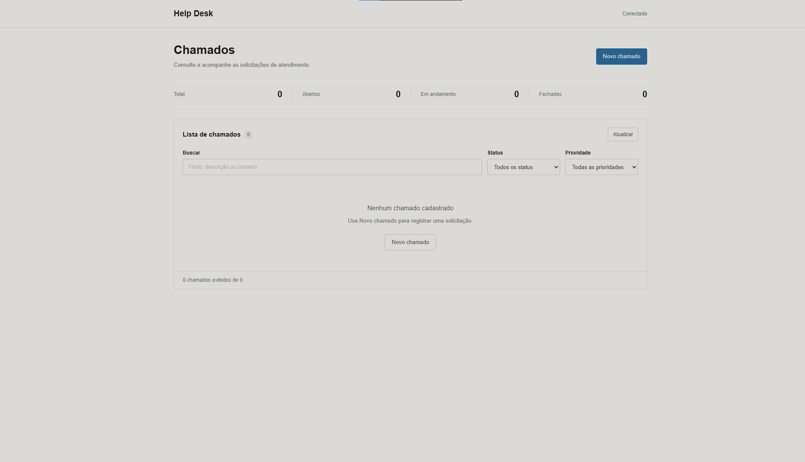
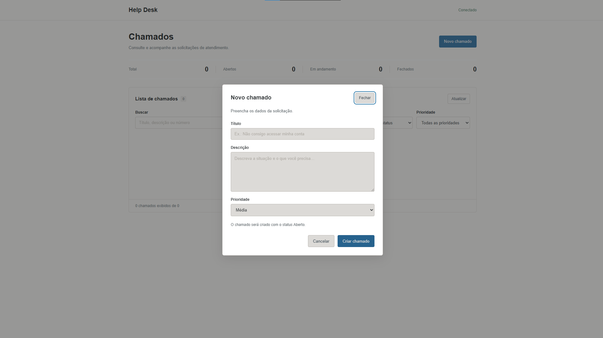
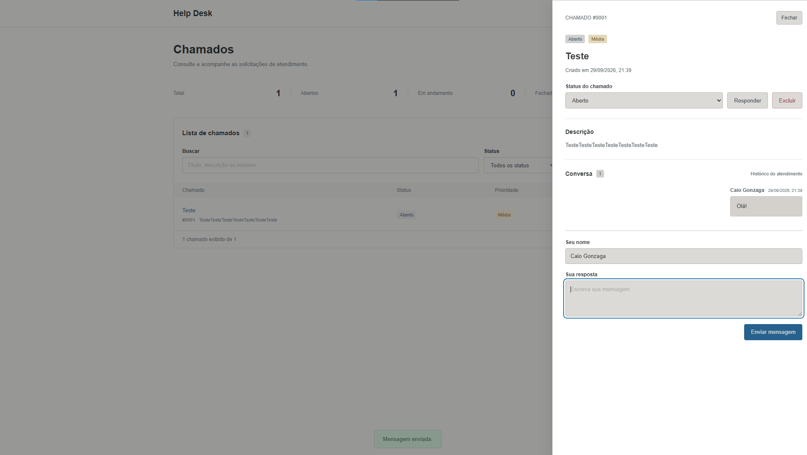

# Help Desk

Sistema de gerenciamento de chamados desenvolvido com Node.js, Express e SQLite.

Permite criar, consultar, filtrar, atualizar e excluir chamados, além de manter
um histórico de mensagens dentro de cada atendimento.

## Preview



### Detalhes do chamado



### Conversa



### Help Desk API

### Tecnologias:
- Node.js
- Express
- SQLite
- JWT
- bcryptjs

### Funcionalidades:
- Cadastro e login
- Autenticação JWT
- Roles user/admin
- CRUD de chamados
- Filtros por status e prioridade
- Controle de acesso por usuário
- Mensagens nos chamados
- Autorização de administrador

## API

### Chamados

GET /chamados

GET /chamados/:id

POST /chamados

PATCH /chamados/:id

DELETE /chamados/:id

### Mensagens

GET /chamados/:id/mensagens

POST /chamados/:id/mensagens

## Executar o projeto

Requer Node.js 24 ou superior.

```bash
git clone LINK_DO_SEU_REPOSITORIO
cd helpdesk-api
npm install
npm start
