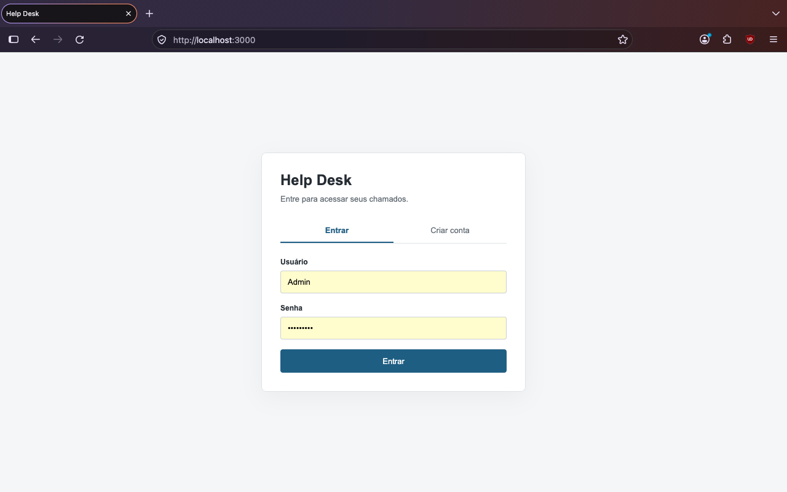
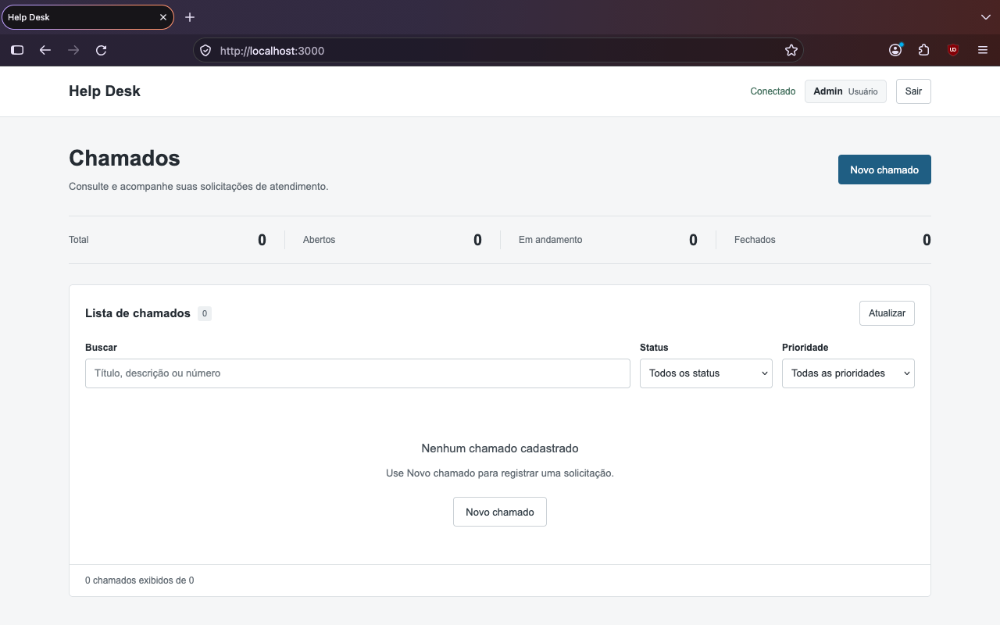
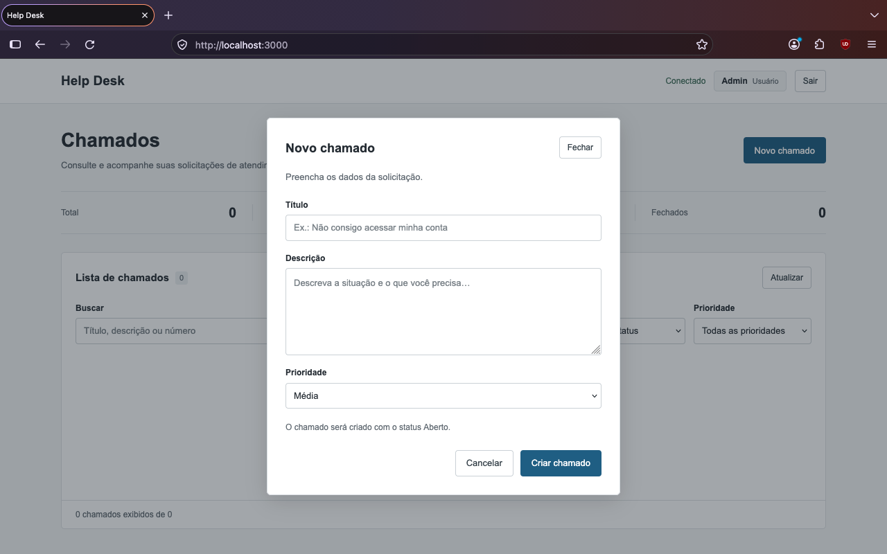
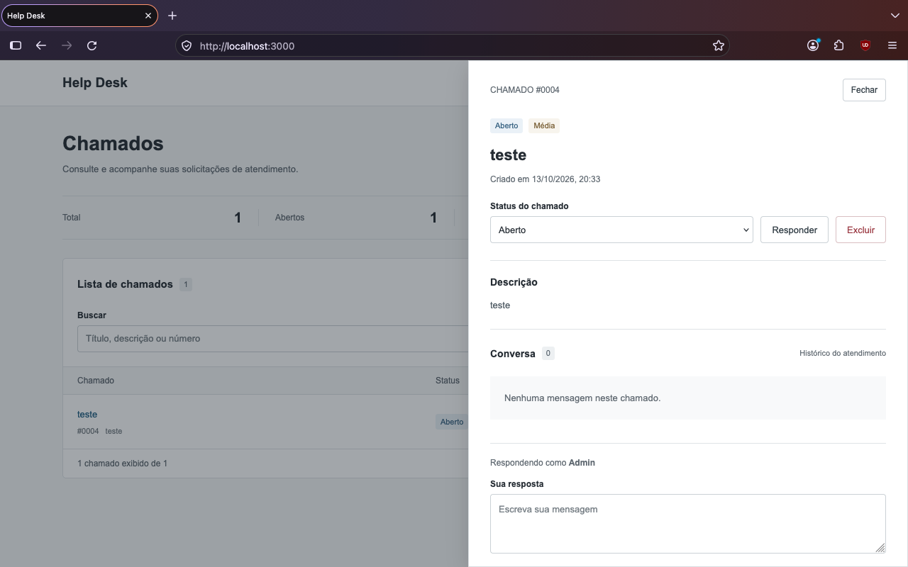

# Help Desk

Sistema de gerenciamento de chamados desenvolvido com **Node.js, Express e SQLite**, com autenticação JWT, controle de acesso por usuário e administrador e interface web integrada à API.

O projeto foi desenvolvido para praticar conceitos de desenvolvimento back-end, APIs REST, autenticação, autorização, banco de dados e integração com front-end.

## Preview

### Login



### Painel de chamados



### Detalhes do chamado



### Histórico de mensagens



## Tecnologias

- JavaScript
- Node.js
- Express
- SQLite
- JWT
- bcryptjs
- HTML
- CSS
- Git e GitHub

## Funcionalidades

- Cadastro de usuários
- Login com autenticação JWT
- Armazenamento seguro de senhas com bcrypt
- Perfis de acesso `user` e `admin`
- Criação de chamados
- Listagem de chamados
- Consulta de chamados por ID
- Atualização de status
- Exclusão de chamados
- Filtros por status e prioridade
- Histórico de mensagens por chamado
- Identificação automática do autor das mensagens
- Controle de acesso por proprietário do chamado
- Painel web integrado à API
- Sessão autenticada utilizando JWT

## Controle de acesso

### Usuário

Usuários comuns podem visualizar e gerenciar apenas os próprios chamados.

Um usuário não pode consultar, alterar, excluir ou visualizar as mensagens de chamados pertencentes a outro usuário.

### Administrador

Administradores possuem acesso aos chamados de todos os usuários e podem consultar, atualizar, excluir e visualizar seus respectivos históricos de mensagens.

## API

### Usuários

```http
POST /usuarios
```

Cria um novo usuário.

### Login

```http
POST /login
```

Realiza a autenticação e retorna um token JWT.

As rotas protegidas utilizam o header:

```http
Authorization: Bearer TOKEN
```

### Chamados

Listar chamados:

```http
GET /chamados
```

Filtrar por status:

```http
GET /chamados?status=Aberto
```

Filtrar por prioridade:

```http
GET /chamados?prioridade=Alta
```

Combinar filtros:

```http
GET /chamados?status=Aberto&prioridade=Alta
```

Consultar um chamado:

```http
GET /chamados/:id
```

Criar um chamado:

```http
POST /chamados
```

Exemplo:

```json
{
  "titulo": "Erro ao acessar sistema",
  "descricao": "O sistema não está permitindo o acesso.",
  "prioridade": "Alta"
}
```

Atualizar o status:

```http
PATCH /chamados/:id
```

Exemplo:

```json
{
  "status": "Em andamento"
}
```

Status disponíveis:

- `Aberto`
- `Em andamento`
- `Fechado`

Excluir um chamado:

```http
DELETE /chamados/:id
```

### Mensagens

Consultar o histórico:

```http
GET /chamados/:id/mensagens
```

Enviar uma mensagem:

```http
POST /chamados/:id/mensagens
```

Exemplo:

```json
{
  "mensagem": "Estou verificando o problema."
}
```

O autor da mensagem é identificado automaticamente através do usuário autenticado.

## Como executar

### Requisitos

- Node.js 24 ou superior
- npm

Clone o repositório:

```bash
git clone https://github.com/caiogonzagasm/helpdesk-api.git
```

Entre na pasta:

```bash
cd helpdesk-api
```

Instale as dependências:

```bash
npm install
```

Crie um arquivo `.env` na raiz do projeto:

```env
JWT_SECRET=sua_chave_secreta
```

O `.env` não deve ser enviado ao GitHub.

Inicie a aplicação:

```bash
npm start
```

Ou utilize o modo de desenvolvimento:

```bash
npm run dev
```

A aplicação estará disponível em:

```text
http://localhost:3000
```

## Estrutura do projeto

```text
helpdesk-api/
├── docs/
│   └── images/
├── public/
│   ├── app.js
│   ├── index.html
│   └── styles.css
├── src/
│   ├── database.js
│   └── index.js
├── .gitignore
├── package.json
└── README.md
```

## Conceitos praticados

- APIs REST
- Métodos HTTP
- CRUD
- Status HTTP
- SQL
- SQLite
- Consultas parametrizadas
- Middleware
- Autenticação
- Autorização
- JWT
- Hash de senhas
- Controle de acesso por roles
- Relacionamento entre usuários e chamados
- Integração entre front-end e back-end
- Git e GitHub

## Autor

**Caio Gonzaga**

Estudante de Análise e Desenvolvimento de Sistemas com foco em desenvolvimento back-end.

- [GitHub](https://github.com/caiogonzagasm)
- [LinkedIn](https://www.linkedin.com/in/caiogonzaga85/)
